# Dynamic Notch (Quickshell)

> [!WARNING]
> **Personal Desktop Setup & Heavy WIP**
> 
> Этот репозиторий полностью **навайбкожен** и сделан исключительно под моё личное рабочее место и привычки (Desktop Hyprland). Проект всё ещё в активной разработке (**WIP**).
> 
> Здесь **отсутствуют многие типичные laptop-функции**: нет индикатора батареи, нет виджетов управления Wi-Fi сетями и Bluetooth (всё завязано на проводной LAN и стационарный ПК).
> 
> Большинство изменений я проверяю и тестирую лично, но из-за нехватки глубоких знаний QML часто полагаюсь на помощь ИИ. Я полностью открыт к любым улучшениям, пуллреквестам и предложениям!
> 
> ---
> 
> This repository is heavily **vibecoded** and tailored exclusively for my personal desktop workflow and habits (Desktop Hyprland). The project is still an active work in progress (**WIP**).
> 
> **Many typical laptop features are completely absent**: there is no battery indicator, no Wi-Fi management widgets, and no Bluetooth controls (everything is tailored for a stationary PC and wired LAN).
> 
> I test and verify most changes personally on my daily setup, but due to limited QML expertise, I frequently rely on AI assistance. I am completely open to community contributions, cleanups, suggestions, and pull requests!

Dynamic Notch and comprehensive Control Center for Wayland (**Hyprland**), built with QML using [Quickshell](https://outfoxxed.me/quickshell/).

---

## Screenshots & Overview

### Notch, Dashboard & OSD Popups

| Compact Notch | Expanded Dashboard |
| :---: | :---: |
| 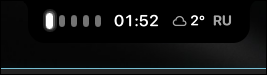<br><sub>**Compact Notch**: Workspace capsules, clock, weather/CPU/LAN stats, layout indicator</sub> | 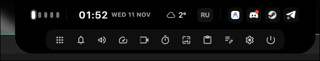<br><sub>**Expanded Dashboard**: Quick system controls, tray area, and dock capsules</sub> |

| Keyboard Layout OSD | Notification Toast OSD |
| :---: | :---: |
| <br><sub>**Keyboard Layout OSD**: Instant badge upon layout switch</sub> | <br><sub>**Notification Toast OSD**: Popup banner in notch on incoming notifications</sub> |

### Interactive Panels

| Launcher & App Search | Integrated Scientific Calculator |
| :---: | :---: |
| 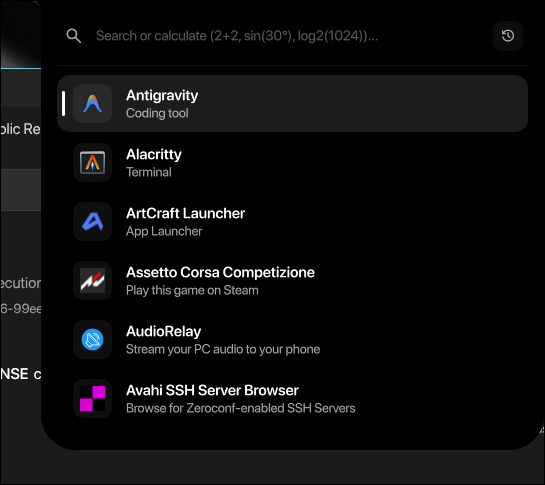<br><sub>**App Launcher**: Instant search, launch frequency ranking and pinning</sub> | 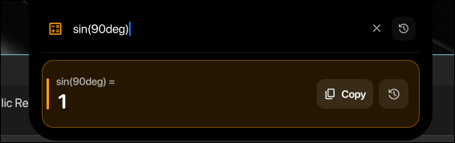<br><sub>**Engineering Calculator**: Trigonometry, logs, factorials, calculation history</sub> |

| Settings & Control Center | Accurate Resource Monitor |
| :---: | :---: |
| 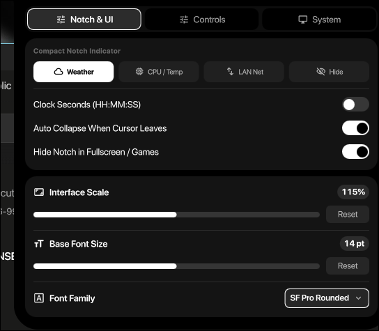<br><sub>**Settings Panel (3 tabs)**: Scale, font family modal, hardware toggles, LAN IP</sub> | 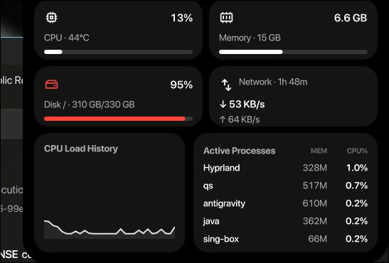<br><sub>**Sysmon**: `/proc` deltas matching `btop`, load sparkline, aligned tabular columns</sub> |

| Audio Mixer & Device Output | Screen Recorder |
| :---: | :---: |
| 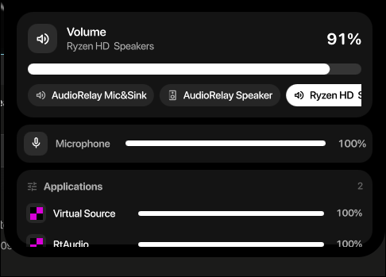<br><sub>**Audio Mixer**: PipeWire output sink switcher, mic bar, per-app streams</sub> | 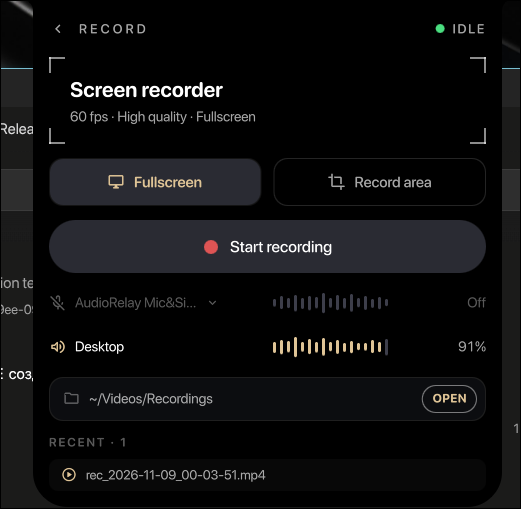<br><sub>**Screen Recorder**: Viewfinder frame, live audio waveforms, FPS and source toggles</sub> |

| Interactive Ruler Timer | Wallpaper Switcher |
| :---: | :---: |
| 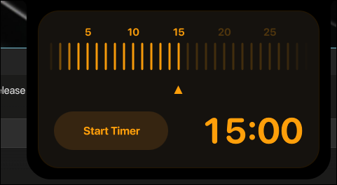<br><sub>**Timer**: Scrubbable horizontal ruler, countdown controls, stopwatch with laps</sub> | 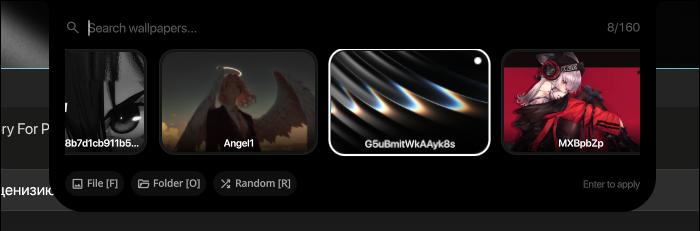<br><sub>**Wallpaper Switcher**: Carousel gallery, folder selection, instant random wallpaper</sub> |

| Weather Forecast | Localized Calendar |
| :---: | :---: |
| 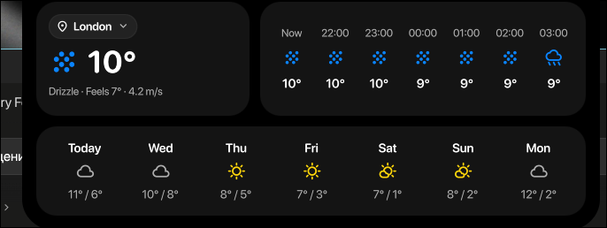<br><sub>**Live Weather**: Hourly & 7-day forecast, global geocoding city search, IP locator</sub> | 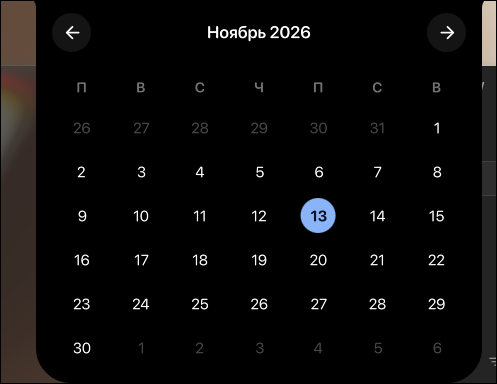<br><sub>**Calendar**: Localized weekday/month, weather badge, month grid navigation</sub> |

| Clipboard History | Notification Center |
| :---: | :---: |
| 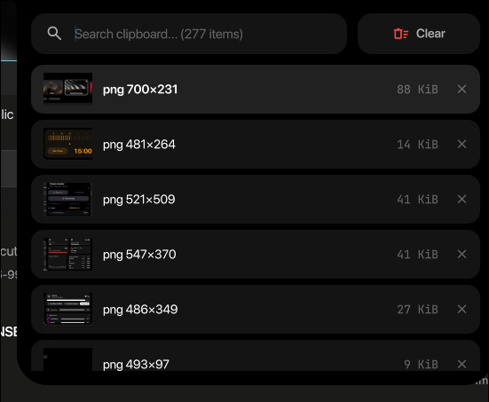<br><sub>**Clipboard History**: Text and image previews via `cliphist` with delete & wipe</sub> | 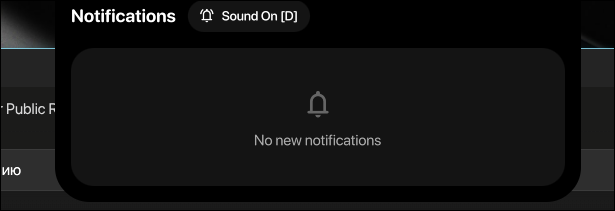<br><sub>**Notification Center**: Notification history, DND switcher, batch clear</sub> |

| Power & Session Menu | |
| :---: | :---: |
| 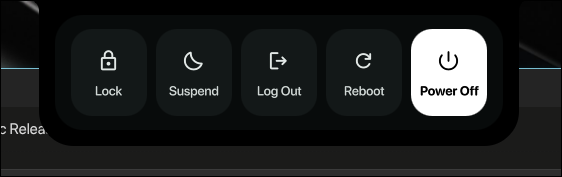<br><sub>**Power Menu**: Lock, Suspend, Log Out, Reboot, Power Off with confirmation</sub> | |

---

## Highlights

- **Dynamic Island / Notch**:
  - Automatically collapses to a sleek top-edge notch with smooth spring animations.
  - Compact widgets: Workspaces capsules with active glow, rolling clock, weather / CPU / LAN stats, and keyboard layout indicator.
  - Dynamic OSD popups on volume changes, keyboard layout switches, and incoming desktop notifications.
  - Native fullscreen and game detection to automatically hide or yield focus during gameplay.
- **Rich Interactive Panels**:
  - **Settings & Control Center (`settings`)**:
    - **Notch & UI**: Compact widget switcher, clock seconds toggle, auto-collapse, interface scale slider, base font size slider, and a searchable modal font family selector with live filtering.
    - **Controls & Audio**: PipeWire audio sink output switcher, microphone mute, brightness slider, night light (`hyprsunset`), Do Not Disturb toggle, game mode toggle, keep-awake inhibitor (`systemd-inhibit`), and quick recording.
    - **System & Tools**: Host and user info, uptime counter, LAN IP card with one-click clipboard copy, region / fullscreen screenshots (`slurp` + `grim`), and quick launchers (`pavucontrol`, `btop`, terminal).
  - **Launcher & Scientific Calculator (`launcher`)**:
    - Instant desktop application search with usage ranking and pinning.
    - Integrated engineering math engine supporting basic arithmetic, factorials (`5!`), trigonometric functions with degree support (`sin(30°)`), logarithms, roots, constants (`pi`, `e`, `tau`), and persistent calculation history with one-click copy.
  - **Wallpaper Switcher (`wallpaper`)**:
    - Compact wallpaper carousel gallery with instant preview, folder selector, random wallpaper hotkey (`R`), and persistent caching with crossfade transitions.
  - **Accurate Resource Monitor (`sysmon`)**:
    - Process and CPU measurement directly parsing `/proc/stat` & `/proc/[pid]/stat` deltas matching `btop` / `htop` (total CPU utilization percentage, memory usage, real-time CPU sparkline, network speed, and top 5 processes with aligned tabular columns).
  - **Interactive Timer & Stopwatch (`timer`)**:
    - Animated horizontal tick ruler with drag scrubbing and wheel adjustment.
    - Dual states (idle preset configuration vs running countdown with pause/reset), plus stopwatch mode with lap history.
  - **Screen Recorder (`recorder`)**:
    - Viewfinder frame with corner brackets, live audio waveform visualizers for mic and desktop, audio source toggles, FPS switcher, and recent recordings management.
  - **Weather Forecast (`weather`)**:
    - Live Open-Meteo weather with condition badges, hourly precipitation/temperature graphs, 7-day outlook, global city geocoding search (Cyrillic & Latin support), automatic IP geolocation, and persistent location caching.
  - **Calendar (`calendar`)**:
    - Dual-card layout with localized dates, weather overview, and interactive month navigation.
  - **Media Player (`media`)**:
    - MPRIS integration with smart YouTube thumbnail extraction, title cleanup, and lazy progress polling (0% idle CPU overhead).
  - **Audio Mixer (`mixer`)**:
    - Master volume, default input/output switcher, and per-application audio stream controls.
  - **Clipboard History (`clipboard`)**:
    - Clipboard history with image thumbnail previews powered by `cliphist` and `wl-copy`.
  - **Quick Notes (`notes`)**:
    - Scratchpad Markdown notes persisted to `~/.local/state/dynamic-notch/notes/`.
  - **Power Menu (`power`)**:
    - Lock screen, suspend, logout, reboot, and power off with confirmation.
  - **Polkit Agent (`auth`)**:
    - Integrated notch authentication prompt for sudo and polkit actions.

---

## Dependencies

### Core
- `quickshell` (Wayland layer-shell engine)
- `hyprland`

### Utilities
- `pipewire`, `wireplumber` (audio control and sink management)
- `cliphist`, `wl-clipboard`, `imagemagick` (clipboard history and thumbnail generation)
- `grim`, `slurp` (screenshot capture and screen region selection)
- `gpu-screen-recorder` (screen and window recording)
- `brightnessctl` (optional, display brightness control)
- `hyprsunset` (optional, night light color temperature)
- `curl` (weather API and IP geolocation)
- `libnotify` (`notify-send` for desktop toast notifications)

### Recommended Fonts
- **Interface**: *Inter*, *Roboto*, *SF Pro Rounded*, or *Adwaita Sans* (configurable via Settings panel)
- **Monospace**: *JetBrainsMono Nerd Font*
- **Icons**: *Material Symbols Rounded*
- **Glyphs**: *Hack Nerd Font Propo*

---

## Installation & Running

### 1. Clone the repository
```bash
git clone https://github.com/your-username/dynamic-notch.git ~/.config/quickshell/dynamic-notch
```

### 2. Manual Test Run
```bash
qs -p ~/.config/quickshell/dynamic-notch
```

### 3. Autostart in Hyprland

#### Hyprland Lua (`hyprland.lua` / v0.57+)
```lua
hl.exec("qs -d -p ~/.config/quickshell/dynamic-notch")
```

#### Classic `hyprland.conf`
```ini
exec-once = qs -d -p ~/.config/quickshell/dynamic-notch
```

---

## IPC Keybindings & Hotkeys

### Hyprland Lua (`hyprland.lua` / v0.57+)

Add these bindings to your Hyprland Lua configuration (e.g., `~/.config/hypr/hyprland/keybinds.lua`):

```lua
local notch_cmd = function(cmd)
    return hl.dsp.exec_cmd("qs -p ~/.config/quickshell/dynamic-notch ipc call island " .. cmd)
end

-- Toggle main notch dashboard
hl.bind("SUPER + Space", notch_cmd("toggle"))

-- Open specific panels directly in notch
hl.bind("SUPER + D", notch_cmd("open launcher"))
hl.bind("SUPER + V", notch_cmd("open clipboard"))
hl.bind("SUPER + N", notch_cmd("open notifications"))
hl.bind("SUPER + M", notch_cmd("open mixer"))
hl.bind("SUPER + W", notch_cmd("open weather"))
hl.bind("SUPER + S", notch_cmd("open settings"))
hl.bind("SUPER + Escape", notch_cmd("close"))

-- Media & Volume keys (with locked/repeating flags)
hl.bind("XF86AudioRaiseVolume", notch_cmd("volUp"), { locked = true, repeating = true })
hl.bind("XF86AudioLowerVolume", notch_cmd("volDown"), { locked = true, repeating = true })
hl.bind("XF86AudioMute",        notch_cmd("mute"), { locked = true })
hl.bind("XF86AudioPlay",        notch_cmd("playPause"), { locked = true })
hl.bind("XF86AudioNext",        notch_cmd("nextTrack"), { locked = true })
hl.bind("XF86AudioPrev",        notch_cmd("prevTrack"), { locked = true })
```

### Classic `hyprland.conf`

```ini
# Toggle the main notch dashboard
bind = SUPER, Space, exec, qs -p ~/.config/quickshell/dynamic-notch ipc call island toggle

# Open specific panels directly in the notch
bind = SUPER, D, exec, qs -p ~/.config/quickshell/dynamic-notch ipc call island open launcher
bind = SUPER, V, exec, qs -p ~/.config/quickshell/dynamic-notch ipc call island open clipboard
bind = SUPER, N, exec, qs -p ~/.config/quickshell/dynamic-notch ipc call island open notifications
bind = SUPER, M, exec, qs -p ~/.config/quickshell/dynamic-notch ipc call island open mixer
bind = SUPER, W, exec, qs -p ~/.config/quickshell/dynamic-notch ipc call island open weather
bind = SUPER, S, exec, qs -p ~/.config/quickshell/dynamic-notch ipc call island open settings
bind = SUPER, Escape, exec, qs -p ~/.config/quickshell/dynamic-notch ipc call island close

# Media & Volume shortcuts
bind = , XF86AudioRaiseVolume, exec, qs -p ~/.config/quickshell/dynamic-notch ipc call island volUp
bind = , XF86AudioLowerVolume, exec, qs -p ~/.config/quickshell/dynamic-notch ipc call island volDown
bind = , XF86AudioMute,        exec, qs -p ~/.config/quickshell/dynamic-notch ipc call island mute
bind = , XF86AudioPlay,        exec, qs -p ~/.config/quickshell/dynamic-notch ipc call island playPause
bind = , XF86AudioNext,        exec, qs -p ~/.config/quickshell/dynamic-notch ipc call island nextTrack
bind = , XF86AudioPrev,        exec, qs -p ~/.config/quickshell/dynamic-notch ipc call island prevTrack
```

---

## Documentation

For architecture details, panel contracts, and service APIs, see [docs/PANELS.md](docs/PANELS.md).
